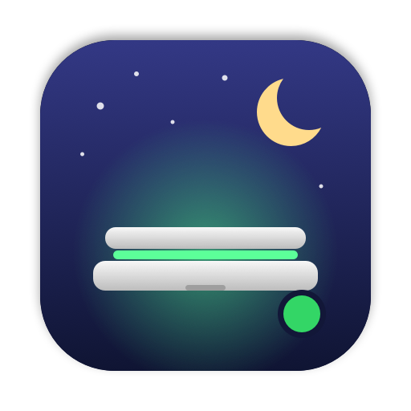
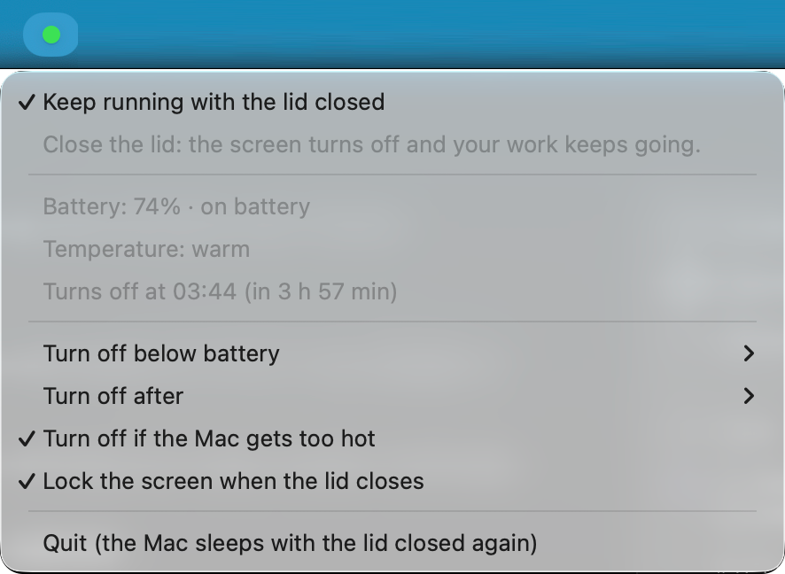

<p align="center">
  
</p>

<h1 align="center">Lid Awake</h1>

<p align="center">A menu bar switch that keeps your Mac running with the lid closed.</p>

Close the lid and the screen turns off and locks, but your builds, downloads and
coding agents keep going. Useful when you have to walk somewhere in the middle of
a long task and don't want to carry an open laptop.

<p align="center">
  
</p>

## What the dot means

- **Green:** closing the lid turns the screen off, locks the session and keeps the Mac running.
- **Red:** closing the lid puts the Mac to sleep as usual.
- **Yellow:** the app lost the permission to change sleep; run `./install.sh` again.

## Safety limits

A Mac that never sleeps can drain its battery or overheat in a bag, so the mode
turns itself off when any of these happens:

| Limit | Default | Options |
| --- | --- | --- |
| Battery, only when not charging | below 20% | 10%, 20%, 30%, never |
| Time since you turned it on | 4 hours | 1, 2, 4, 8 hours, no limit |
| macOS reports critical thermal pressure | on | on, off |

The menu shows the battery, the temperature level, when the mode will turn off,
and why it last turned off on its own. Quitting the app, logging out, or
stopping its LaunchAgent also turns the mode off, so the Mac is never left unable
to sleep.

**Lock the screen when the lid closes** is on by default. It puts the display to
sleep when the lid closes, which locks the session if *Require password after
screen saver begins or display is turned off* is set to *Immediately* in System
Settings → Lock Screen.

MacBook Airs have no fan. Under heavy load in a closed bag they throttle and get
warm, which is why the heat limit is on by default.

## Install

Requires macOS 14 or newer and Apple's Command Line Tools (`xcode-select --install`).
No other dependencies.

```sh
git clone https://github.com/Yclpaiva/lid-awake.git
cd lid-awake
./install.sh
```

The installer:

1. runs the checks and builds `Lid Awake.app` into `~/Applications`;
2. asks once for your admin password to add `/etc/sudoers.d/lid-awake`, which lets
   your user run exactly `pmset -a disablesleep 0` and `pmset -a disablesleep 1`
   without a password, and nothing else;
3. adds a LaunchAgent so the app starts at login.

Running it again is safe: it skips the rebuild when nothing changed, so it won't
restart the app or turn the mode off.

```sh
./install.sh --check      # verify app, sudo rule, LaunchAgent and a recent status
./install.sh --uninstall  # remove the app, the LaunchAgent and the sudo rule
```

## How it works

There is no public API to keep a Mac awake with the lid closed without an
external display. The `caffeinate` command and most "keep awake" apps only stop
idle sleep; closing the lid still sleeps the Mac. `pmset -a disablesleep 1` does
stop lid-closed sleep, and it needs root, hence the narrow sudo rule.

Every five seconds the app reads `SleepDisabled` and `AppleClamshellState` from
`IOPMrootDomain`, the battery from IOKit power sources and the thermal state from
`ProcessInfo`, then applies the limits. It writes its state to
`~/Library/Application Support/Lid Awake/status.json`, which `--check` reads.

## Languages

The interface follows the language order in System Settings: English, or
Brazilian Portuguese when it comes first. Strings live in
`Resources/*.lproj/Localizable.strings`, keyed by their English text. The build
fails if a key in the code has no translation or a translation changes its
format specifiers. To try Portuguese without changing the system, quit the app
and run:

```sh
~/Applications/Lid\ Awake.app/Contents/MacOS/LidAwake -AppleLanguages '(pt-BR)'
```

## Development

```sh
Scripts/build.sh      # checks + .build/Lid Awake.app
Scripts/make-icon.sh  # redraws Resources/AppIcon.icns and docs/images/logo.png
```

The stop rules live in `Sources/StopPolicy.swift` and are covered by
`Tests/main.swift`.

## License

MIT
